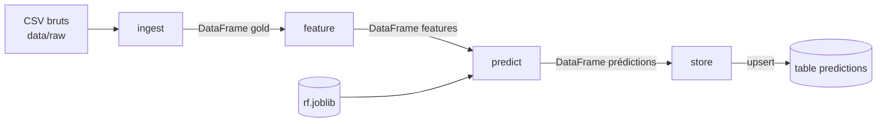

# Design du flow M29–M30 — ingest → feature → predict → store

Objectif : chaque cycle lit les données capteurs, calcule les features, prédit la probabilité de
panne par machine et historise le résultat dans la table `predictions`, **sans doublon** si le flow
est rejoué. Ce document fige les contrats **avant** l'implémentation (M30).

## Diagramme

## Contrats des tasks

| Task | Entrée | Sortie | Erreurs possibles | Effet de bord | Retry | Clé d'idempotence |
| --- | --- | --- | --- | --- | --- | --- |
| `ingest` | `data_dir` : 3 sources (température, pression, incidents) | DataFrame gold : `machine`, `timestamp`, `temperature`, `pressure_bar`, `panne` | fichier absent ; colonne manquante ; `machine_id` sans numéro (`ValueError`) | aucun (lecture seule) | non : erreurs déterministes | sans objet (n'écrit rien) |
| `feature` | DataFrame gold | DataFrame features : lags 1/3/6 et moyennes glissantes 3/6 par machine, lignes incomplètes retirées | colonnes manquantes (`ValueError`) | aucun (calcul pur) | non : calcul pur, même résultat à chaque essai | sans objet |
| `predict` | DataFrame features + `model_path` (`artifacts/models/rf.joblib`) | DataFrame prédictions : `machine`, `prediction_ts`, `proba_panne`, `decision` (`alerte` si proba ≥ seuil, sinon `ok`) | modèle absent (`FileNotFoundError`) ; colonnes différentes de celles de l'entraînement | aucun (lecture du modèle) | non : un modèle absent le restera | sans objet |
| `store` | DataFrame prédictions + `db_url` | nombre de lignes upsertées (`int`) | base indisponible ou verrouillée (transitoire) ; violation de schéma (déterministe) | **écrit** dans la table `predictions` | **oui** : `retries=3`, backoff `[5, 15, 45]` s, base = ressource externe | `(machine, prediction_ts)` = `PRIMARY KEY` + `INSERT … ON CONFLICT … DO UPDATE` (upsert) |

### Points d'attention

- **Fuite inter-machines (ingest)** : la jointure température/pression se fait par
  `merge_asof(..., by="machine", tolerance=±90 min, direction="nearest")`. Sans `by="machine"`,
  une machine hérite de la pression d'une autre **sans aucune erreur**. Les lignes sans pression
  dans la tolérance sont retirées : résidu non-joint ≈ 1,76 %.
- **Retries ciblés** : seule `store` touche une ressource externe. Réessayer `ingest`, `feature`
  ou `predict` referait le même calcul et échouerait de la même façon.
- **Idempotence** : `store` est la seule task qui écrit, donc la seule qui a besoin d'une clé.
  Rejouer le flow met à jour les lignes existantes au lieu d'en ajouter.
- **Pas de fuite temporelle (feature)** : les moyennes glissantes utilisent `shift(1)`, donc
  uniquement le passé (rappel M23).

## Preuves attendues

- Deux executions sur la meme fenetre ne dupliquent aucune ligne.
- Un echec intermediaire peut etre repris sans recommencer aveuglement.
- Chaque run porte un nom et des parametres retrouvables.
